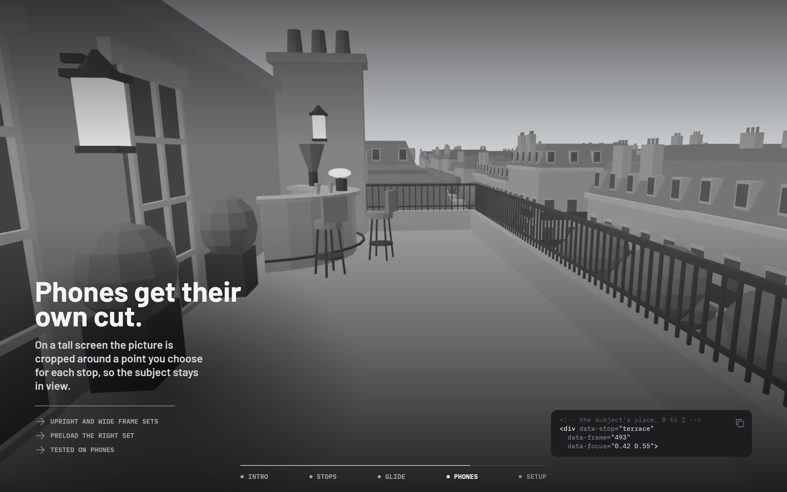

# flythrough

A scroll-driven video player with named stops. The page scroll plays a video's
frames, and the flight pauses at stops along the way, each with its own card.
It is a web component, `<fly-through>`, built on GSAP with optional Lenis,
or [without GSAP](#without-gsap).

**[See the demo](https://xjenosa.github.io/flythrough/)**



- Plays frames on a canvas in the same animation frame as the scroll, and
  blends neighbouring frames so slow scrolling stays smooth. Frames are
  decoded in the background near the visitor, so scrolling never waits on
  them.
- Named stops with cards, a progress bar of labels, and passing moments
  between stops.
- Comes to rest by itself: stop scrolling near a card and it glides to that
  stop. It never pulls on the page content above or below it.
- Loads in passes behind a short loading screen. A frame that fails is
  retried, and the loading screen always lifts in the end: after 20 seconds
  with nothing arriving it lifts on what is in. If no frame loads at all,
  the player steps aside.
- Fills the screen, or sits in the page as a box of your size.
- Starts lazily: a player further down the page downloads nothing until the
  visitor is near it.
- Phones get a frame set cropped around each stop's focus point.
- Reduced motion, a data saver and a 2G connection get one still per stop
  and ordinary scrolling.
- A poster picture fills the player before its frames arrive, and stands in
  for it when scripting is off.
- Includes a frame maker: `npx flythrough frames video.mp4 --out public/tour`.
  It can trim the video, thin it to a frame count, write WebP or AVIF, and
  ends with a report of what the frames weigh.

## Install

```sh
npm install flythrough gsap
```

`gsap` is a peer dependency; `lenis` is optional (see [Lenis](#lenis)). A
site that does not use GSAP can leave it out of its pages with
`flythrough/no-gsap` (see [Without GSAP](#without-gsap)). The frame maker also needs `sharp`, and `ffmpeg` on the
computer or the `ffmpeg-static` package (see
[Making frames](#making-frames)).

The imports in this README are for a project with a bundler (Vite, Next,
Nuxt, Astro, SvelteKit, webpack). A page with no build step can load the
same files straight from a CDN: see
[Without a build step](#without-a-build-step). Node 20.19 or later (on Node
22: 22.12 or later).

## Quick start

1. Turn a video into frames (the frame maker needs `sharp`; see
   [Making frames](#making-frames) for ffmpeg):

   ```sh
   npm install --save-dev sharp
   npx flythrough frames flight.mp4 --out public/tour
   ```

   This writes `public/tour/manifest.json` and a folder of WebP frames.

2. Put the element on a page. Each child with `data-stop` is a stop and
   its card: where it sits in the video, its name on the bar, and what the
   card says.

   ```html
   <fly-through src="/tour/manifest.json">
     <div data-stop="door" data-frame="49" data-label="Entrance">Welcome in</div>
     <div data-stop="lobby" data-frame="121" data-label="Lobby">The lobby</div>
     <div data-stop="overview" data-frame="720" data-label="Overview">The whole hotel</div>
   </fly-through>
   ```

3. Load the element and its stylesheet:

   ```js
   import 'flythrough';
   import 'flythrough/style.css';
   ```

4. Take the browser's own margin off the page, so the player starts at the
   very top:

   ```css
   body { margin: 0; }
   ```

   With the margin left on (8 px in every browser), the page opens a few
   pixels above the player, which counts as content above it: the tour
   then does not open by itself (no `intro`, no jump to the first stop).
   The console says so.

Importing `flythrough` defines `<fly-through>`, and every one already on the
page starts at once (one far down the page waits until the visitor is near
it, see [Lazy start](#behaviour)). Settings are attributes; most can be
changed while the player runs (see
[Changing settings](#changing-settings-while-it-runs)).

A stop is placed by `data-frame`, the number of the frame it sits on
(`0121.webp` is frame 121); or by `data-time`, seconds into the video; or
by `data-at`, from 0 (first frame) to 1 (last frame). See [Stops](#stops).

## Astro

```astro
---
import Flythrough from 'flythrough/astro';
---
<Flythrough src="/tour/manifest.json" intro legs={[0.45, 1.3]}>
  <div data-stop="door" data-frame="49" data-label="Entrance">Welcome in</div>
</Flythrough>
```

The component takes the attributes below as props, in camelCase
(`returnToFirst`, `loadingText`, `barLabel`); `legs` is an array, and so is
`stops` if you would sooner pass the stops than write them on the cards. It
loads the stylesheet and the element for you.

- `class`, `id`, `style` and any `data-*` attribute are passed on to the
  element. A class from the page's own `<style>` block applies to the
  player, so the box of [A player in a section](#a-player-in-a-section) can
  be written there:

  ```astro
  <Flythrough class="inline" src="/tour/manifest.json">...</Flythrough>

  <style>
    .inline { --ft-stage-height: 60vh; max-width: 960px; margin-inline: auto; }
  </style>
  ```

  Rules that name the player's own parts (`.ft__stage`,
  `.ft__overlays > [data-stop]`, `.ft__still`) go in a global stylesheet or
  a `<style is:global>` block: Astro's scoped styles only reach elements
  the page itself wrote. A card's own class, written in the page, is fine.
- Code that talks to the player goes in a `<script>` on the page:

  ```astro
  <script>
    customElements.whenDefined('fly-through').then(() => {
      const player = document.querySelector('fly-through')!;
      player.holdLoading(1200);
    });
  </script>
  ```

  An Astro script is TypeScript: the `!` says the player is on the page
  (without it `astro check` reports that it may be missing). With Astro's
  view transitions (`<ClientRouter />`) a page's script runs once, not on
  every visit to the page: put that code in a listener for
  `astro:page-load`. The player itself needs nothing: it starts whenever
  the element comes into a page.
- The component loads the default entry. For
  [`flythrough/no-gsap`](#without-gsap), write the element itself and
  import the entry and the stylesheet in a script:

  ```astro
  <fly-through src="/tour/manifest.json">
    <p data-moment="line" data-from="0.1" data-to="0.4">One long shot</p>
  </fly-through>

  <script>
    import 'flythrough/no-gsap';
    import 'flythrough/style.css';
  </script>
  ```

## Frameworks

React and Vue have a ready-made component, `<Flythrough>`, like the Astro
one. Svelte uses the element itself, and so can React and Vue: it is an
ordinary HTML element.

A player without stops is a plain scrub: the scroll plays the footage, with
no cards, no bar and no coming to rest. Lines can still pass by with
`data-moment`. A page can hold several players; one far down the page waits
until the visitor is near it (see Lazy start under
[Behaviour](#behaviour)).

The code below is cut from the projects in
[examples/](https://github.com/xjenosa/flythrough/tree/main/examples). The
test suite builds each one for production and runs it in Chromium, Firefox
and WebKit, both as a server-rendered page taken over in the browser and as
an empty page the browser fills, from the source and again from the packed
package. It also installs the package into a real Next (App Router) project
and a real Nuxt project, builds them and runs them in Chromium.

### React and Next

`flythrough/react` is the component:

<!-- snippet: examples/react/src/App.tsx#imports -->
```tsx
import { useRef, useState } from 'react';
import { Flythrough, type FlythroughElement } from 'flythrough/react';
import 'flythrough/style.css';
```
<!-- /snippet -->

<!-- snippet: examples/react/src/App.tsx#component -->
```tsx
<Flythrough
  ref={player}
  src="/tour/manifest.json"
  intro
  bar={bars ? undefined : 'off'}
  onReady={() => setReady(true)}
  onStop={(e) => setAt(e.detail.active ? e.detail.id : null)}
>
  {stops.map((s) => (
    <h2 key={s.id} data-stop={s.id} data-at={s.at} data-label={s.label}>
      {s.label}
    </h2>
  ))}
</Flythrough>
<p className="tour-status">{ready ? (at ?? 'between stops') : 'loading'}</p>
<button type="button" onClick={() => player.current?.goToStop(0)}>
  Back to the first stop
</button>
```
<!-- /snippet -->

- **Props** are the [attributes](#attributes) in camelCase
  (`returnToFirst`, `loadingText`, `barLabel`). `intro` is a boolean,
  `legs` an array. The stops are written on the cards, as above, or passed
  as an array: `stops={[{ id: 'door', frame: 49, label: 'Entrance' }]}`.
- **Events** are props: `onReady`, `onProgress`, `onStop`. Each gets the
  event, with a typed `e.detail` (see [JavaScript](#javascript)).
- **The ref** is the element itself
  (`useRef<FlythroughElement>(null)`), with its methods: `goToStop`,
  `useLenis`, `holdLoading`.
- **Props stay live.** Changing one changes the running player (`bar`
  above), for every setting that can change (see
  [Changing settings](#changing-settings-while-it-runs)). Another `src`,
  another `mode` or another set of direct children is a different tour:
  the component builds a new player for it by itself. A visitor who was
  inside the old tour is taken to the top of the new one, which opens as on
  a fresh visit (not with `autoscroll="off"`, and not when the old one
  showed stills, which do not say where the visitor is).
- **Direct children.** Cards, moments and the poster are written as direct
  children of the component, and each one that comes, goes or changes
  place makes a new player (the tour starts over), see below. What is
  inside a card or a moment can change freely. Do not make a direct child
  of a component of your own that sometimes renders nothing: the player
  moves its children into its stage, and React cannot follow one it did
  not see coming.
- **Server rendering.** The cards are in the server's HTML and the player
  is loaded in the browser, once React has taken the page over. The file is
  marked `'use client'`, so in Next's App Router it can be written in a
  server component; one that passes event handlers or a ref belongs in a
  client component, as always.
- **The stylesheet** is yours to import (`flythrough/style.css`), once.
- `gsap="off"` loads the player [without GSAP](#without-gsap).
- **Next.** A new Next project's `globals.css` sets `overflow-x: hidden` on
  `html` and `body`, which stops the picture staying in place while the
  page scrolls (see [Behaviour](#behaviour), No `overflow: hidden` around
  it). Change it to `overflow-x: clip`; the player's console warning names
  the element.

A direct child that comes or goes:

<!-- snippet: examples/react/src/NoteApp.tsx#note -->
```tsx
<Flythrough src="/tour/manifest.json">
  {poster && }
  <h2 data-stop="entrance" data-frame="49">
    Entrance
  </h2>
  {/* Shown or hidden, a direct child makes a new player: the tour
      starts over. */}
  {note && (
    <p data-moment="note" data-from="0.1" data-to="0.15">
      Up the stairs
    </p>
  )}
  <h2 data-stop="lobby" data-frame="121">
    Lobby
  </h2>
</Flythrough>
```
<!-- /snippet -->

A plain scrub, as a second player on the page:

<!-- snippet: examples/react/src/App.tsx#scrub -->
```tsx
{/* A plain scrub: no stops, one line passing by. */}
<Flythrough src="/tour/manifest.json" length={6}>
  <p data-moment="line" data-from="0.1" data-to="0.4">
    One long shot
  </p>
</Flythrough>
```
<!-- /snippet -->

#### The element itself in React

`flythrough/react` also teaches JSX the `<fly-through>` element and its
attributes, for a project that would sooner not use the component.
[Four things](#the-element-itself-in-any-framework) are then yours to do:

<!-- snippet: examples/react/src/Tour.tsx -->
```tsx
'use client';

import { useEffect, useRef, useState, type ReactNode } from 'react';
import type { Flythrough, Stop } from 'flythrough';
import type {} from 'flythrough/react';
import 'flythrough/style.css';

export function Tour({ src, stops, children }: { src: string; stops: Stop[]; children: ReactNode }) {
  const player = useRef<Flythrough>(null);
  const [ready, setReady] = useState(false);
  const [at, setAt] = useState<string | null>(null);

  useEffect(() => {
    // Loaded in the browser, after React has matched the page: the player
    // moves the cards into its own stage.
    void import('flythrough');
    // Listened to here, not as props: on a page the server rendered, React
    // does not bind a custom element's events.
    const el = player.current!;
    const off = new AbortController();
    el.addEventListener('flythrough-ready', () => setReady(true), { signal: off.signal });
    el.addEventListener('flythrough-stop', (e) => setAt(e.detail.active ? e.detail.id : null), { signal: off.signal });
    return () => off.abort();
  }, []);

  return (
    <>
      <fly-through ref={player} src={src} stops={JSON.stringify(stops)} intro>
        {children}
      </fly-through>
      <p className="tour-status">{ready ? (at ?? 'between stops') : 'loading'}</p>
      <button type="button" onClick={() => player.current?.goToStop(0)}>
        Back to the first stop
      </button>
    </>
  );
}
```
<!-- /snippet -->

Using it, with the key that builds a new player for another set of cards:

<!-- snippet: examples/react/src/PlainApp.tsx#usage -->
```tsx
{/* Another set of cards is another player: the key makes React
    build a new one (the player has moved the old cards). */}
<Tour key={short ? 'short' : 'full'} src="/tour/manifest.json" stops={stops}>
  {stops.map((s) => (
    <h2 key={s.id} data-stop={s.id}>
      {s.label}
    </h2>
  ))}
</Tour>
<button type="button" className="switch" onClick={() => setShort(!short)}>
  {short ? 'The whole tour' : 'The short tour'}
</button>

{/* A plain scrub: no stops, one line passing by. A second player on a
    page needs nothing special. */}
<fly-through src="/tour/manifest.json" length="6">
  <p data-moment="line" data-from="0.1" data-to="0.4">
    One long shot
  </p>
</fly-through>
```
<!-- /snippet -->

### Vue and Nuxt

`flythrough/vue` is the component:

<!-- snippet: examples/vue/src/App.vue#imports -->
```vue
import { ref } from 'vue';
import { Flythrough, type FlythroughRef } from 'flythrough/vue';
import 'flythrough/style.css';
```
<!-- /snippet -->

<!-- snippet: examples/vue/src/App.vue#state -->
```vue
const player = ref<FlythroughRef | null>(null);
const ready = ref(false);
const at = ref<string | null>(null);
const bars = ref(true);

function onStop(e: HTMLElementEventMap['flythrough-stop']) {
  at.value = e.detail.active ? e.detail.id : null;
}
```
<!-- /snippet -->

<!-- snippet: examples/vue/src/App.vue#component -->
```vue
<Flythrough ref="player" src="/tour/manifest.json" intro :bar="bars ? undefined : 'off'" @ready="ready = true" @stop="onStop">
  <h2 v-for="s in stops" :key="s.id" :data-stop="s.id" :data-at="s.at" :data-label="s.label">{{ s.label }}</h2>
</Flythrough>
<p class="tour-status">{{ ready ? (at ?? 'between stops') : 'loading' }}</p>
<button type="button" @click="player?.element?.goToStop(0)">Back to the first stop</button>
```
<!-- /snippet -->

- **Props** are the [attributes](#attributes) (`return-to-first`,
  `loading-text` and `bar-label` in a template, as Vue writes props).
  `intro` is a boolean, `legs` an array. The stops are written on the cards,
  as above, or passed as an array:
  `:stops="[{ id: 'door', frame: 49, label: 'Entrance' }]"`.
- **Events**: `@ready`, `@progress`, `@stop`. Each gets the event, with a
  typed `e.detail` (see [JavaScript](#javascript)).
- **A template ref** on the component
  (`ref<FlythroughRef | null>(null)`) holds the element itself under
  `element`, with its methods: `goToStop`, `useLenis`, `holdLoading`.
- **Props stay live.** Changing one changes the running player (`bar`
  above), for every setting that can change (see
  [Changing settings](#changing-settings-while-it-runs)). Another `src`,
  another `mode` or another set of nodes in the slot is a different tour:
  the component builds a new player for it by itself. A visitor who was
  inside the old tour is taken to the top of the new one, which opens as on
  a fresh visit (not with `autoscroll="off"`, and not when the old one
  showed stills, which do not say where the visitor is).
- **The slot.** Cards, moments and the poster are written straight into the
  slot, and each one that comes, goes or changes place (a `v-if`) makes a
  new player (the tour starts over), see below. What is inside a card or a
  moment can change freely. Do not put a component of your own there that
  sometimes renders nothing: the player moves the slot's elements into its
  stage, and Vue cannot follow one it did not see coming.
- **Server rendering.** The cards are in the server's HTML and the player
  is loaded in the browser, once Vue has taken the page over. Nuxt needs
  nothing in its config.
- **The stylesheet** is yours to import (`flythrough/style.css`), once.
- `gsap="off"` loads the player [without GSAP](#without-gsap).

A node of the slot that comes or goes:

<!-- snippet: examples/vue/src/NoteApp.vue#note -->
```vue
<Flythrough src="/tour/manifest.json">
  
  <h2 data-stop="entrance" data-frame="49">Entrance</h2>
  <!-- Shown or hidden, a node of the slot makes a new player: the tour
       starts over. -->
  <p v-if="note" data-moment="note" data-from="0.1" data-to="0.15">Up the stairs</p>
  <h2 data-stop="lobby" data-frame="121">Lobby</h2>
</Flythrough>
```
<!-- /snippet -->

A plain scrub, as a second player on the page:

<!-- snippet: examples/vue/src/App.vue#scrub -->
```vue
<!-- A plain scrub: no stops, one line passing by. -->
<Flythrough src="/tour/manifest.json" :length="6">
  <p data-moment="line" data-from="0.1" data-to="0.4">One long shot</p>
</Flythrough>
```
<!-- /snippet -->

#### The element itself in Vue

Without the component, tell Vue that `<fly-through>` is a custom element:

<!-- snippet: examples/vue/vite.config.mjs#config -->
```js
// <fly-through> is a custom element, not a Vue component. In Nuxt the
// same option is vue.compilerOptions.isCustomElement in nuxt.config.
vue({ template: { compilerOptions: { isCustomElement: (tag) => tag === 'fly-through' } } }),
```
<!-- /snippet -->

[Four things](#the-element-itself-in-any-framework) are then yours to do:

<!-- snippet: examples/vue/src/Tour.vue -->
```vue
<script setup lang="ts">
import { onMounted, ref } from 'vue';
import type { Flythrough, Stop } from 'flythrough';
import 'flythrough/style.css';

defineProps<{ src: string; stops: Stop[] }>();
const player = ref<Flythrough | null>(null);
const ready = ref(false);
const at = ref<string | null>(null);

// Loaded in the browser, after Vue has matched the page: the player moves
// the cards into its own stage.
onMounted(() => import('flythrough'));

function onStop(e: HTMLElementEventMap['flythrough-stop']) {
  at.value = e.detail.active ? e.detail.id : null;
}
</script>

<template>
  <fly-through ref="player" :src="src" :stops="JSON.stringify(stops)" intro @flythrough-ready="ready = true" @flythrough-stop="onStop">
    <slot />
  </fly-through>
  <p class="tour-status">{{ ready ? (at ?? 'between stops') : 'loading' }}</p>
  <button type="button" @click="player?.goToStop(0)">Back to the first stop</button>
</template>
```
<!-- /snippet -->

Using it:

<!-- snippet: examples/vue/src/PlainApp.vue#usage -->
```vue
<!-- Another set of cards is another player: the key makes Vue build a
     new one (the player has moved the old cards). -->
<Tour :key="short ? 'short' : 'full'" src="/tour/manifest.json" :stops="stops">
  <h2 v-for="s in stops" :key="s.id" :data-stop="s.id">{{ s.label }}</h2>
</Tour>
<button type="button" class="switch" @click="short = !short">
  {{ short ? 'The whole tour' : 'The short tour' }}
</button>

<!-- A plain scrub: no stops, one line passing by. A second player on a
     page needs nothing special. -->
<fly-through src="/tour/manifest.json" length="6">
  <p data-moment="line" data-from="0.1" data-to="0.4">One long shot</p>
</fly-through>
```
<!-- /snippet -->

### Svelte and SvelteKit

Svelte has no component of its own because it needs none: Svelte sets a
custom element's attributes, binds its events in the markup (on a
server-rendered page too) and hands you the element with `bind:this`. A
wrapper would add a file and take nothing away.

<!-- snippet: examples/svelte/src/Tour.svelte -->
```svelte
<script lang="ts">
  import { onMount, type Snippet } from 'svelte';
  import type { Flythrough, Stop } from 'flythrough';
  import 'flythrough/style.css';

  let { src, stops, children }: { src: string; stops: Stop[]; children: Snippet } = $props();
  let player: Flythrough | undefined = $state();
  let ready = $state(false);
  let at: string | null = $state(null);

  // Loaded in the browser, after Svelte has matched the page: the player
  // moves the cards into its own stage.
  onMount(() => {
    void import('flythrough');
  });

  function onStop(e: HTMLElementEventMap['flythrough-stop']) {
    at = e.detail.active ? e.detail.id : null;
  }
</script>

<fly-through bind:this={player} {src} stops={JSON.stringify(stops)} intro onflythrough-ready={() => (ready = true)} onflythrough-stop={onStop}>
  {@render children()}
</fly-through>
<p class="tour-status">{ready ? (at ?? 'between stops') : 'loading'}</p>
<button type="button" onclick={() => player?.goToStop(0)}>Back to the first stop</button>
```
<!-- /snippet -->

Using it:

<!-- snippet: examples/svelte/src/App.svelte#usage -->
```svelte
<!-- Another set of cards is another player: the key block makes Svelte
     build a new one (the player has moved the old cards). -->
{#key short}
  <Tour src="/tour/manifest.json" {stops}>
    {#each stops as s (s.id)}
      <h2 data-stop={s.id}>{s.label}</h2>
    {/each}
  </Tour>
{/key}
<button type="button" class="switch" onclick={() => (short = !short)}>
  {short ? 'The whole tour' : 'The short tour'}
</button>

<!-- A plain scrub: no stops, one line passing by. A second player on a
     page needs nothing special. -->
<fly-through src="/tour/manifest.json" length="6">
  <p data-moment="line" data-from="0.1" data-to="0.4">One long shot</p>
</fly-through>
```
<!-- /snippet -->

### The element itself in any framework

Four things hold wherever `<fly-through>` is written directly (the React
and Vue components do them for you):

- **Settings are attributes, written as text.** Stops usually come from
  data, so pass them as the `stops` attribute through `JSON.stringify`
  (and `legs` the same way) instead of writing them on the cards. A server
  then renders them into the page like any other attribute.
- **Load the player in the browser, once the page is mounted**
  (`import('flythrough')` in the framework's mount hook). The player moves
  the cards into its own stage, and on a server-rendered page the framework
  has to match the page first. The stylesheet is imported at the top as
  usual: it keeps the cards hidden until the player places them. Importing
  either on a server is safe.
- **A different tour is a new player.** Settings can change while the
  player runs (see [Changing settings](#changing-settings-while-it-runs)),
  and so can the text inside a card. A different set of cards, another
  `src` or another `mode` cannot: the player has moved the cards, and the
  framework no longer finds them where it put them. Give the component a
  new key instead: the framework then builds a new player and the old one
  cleans up after itself. Scroll the page to the player's top as you swap
  (the components do): the visitor's old place means nothing in the new
  tour, and a browser that keeps the content below a growing element in
  view would leave them past it. Before the swap, note whether the visitor
  is inside the tour (the old player's `position` is above 0 and below 1);
  after it, if they were, go to the new player's top:
  `window.scrollTo({ top: player.getBoundingClientRect().top + window.scrollY, behavior: 'instant' })`.
- **The events are typed.** `flythrough-ready`, `flythrough-progress` and
  `flythrough-stop` are in TypeScript's event maps (on elements, `document`
  and `window`), so a listener knows `e.detail` without a cast. The detail
  types are exported as `ProgressDetail` and `StopDetail`. In React, add the
  listeners in an effect, not as props: on a page a server rendered, React
  does not bind a custom element's events.

## Attributes

| Attribute | Default | What it does |
| --- | --- | --- |
| `src` | (required) | URL of the `manifest.json` the frame maker wrote. |
| `stops` | the cards | JSON array of stops, for frameworks; without it the stops are read from the cards (see [Stops](#stops)). |
| `intro` | off | Open on frame 0 and glide to the first stop once loaded. Written bare (`intro`); `intro="off"` or `"false"` is off. |
| `autoscroll` | `auto` | Whether the player may move the page as it loads (the intro glide, or the jump to the first stop). `auto`: only when the page opens with the player at the top of the screen, so content above it is never scrolled away from (a page margin of a few pixels is content above it, see [Quick start](#quick-start)). `off`: never. |
| `return-to-first` | `on` with `intro`, else `off` | Anywhere in the track above the first stop is not a place to rest: half a second after scrolling stops there, the player flies back to the first stop at the intro's pace, so coming back from the top replays the opening. |
| `snap` | on | `snap="off"` turns off the pull to the stop whose card is showing. `return-to-first` still works. |
| `glide` | `fixed` | How long the glide to rest takes. `fixed`: 1.1 s however far. `scaled`: by distance, 0.6 s plus 0.8 s per screen height travelled, 1.4 s at most, so a short nudge settles quickly and a long return takes its time. The intro, label taps and the return to the first stop keep their own timing. |
| `reach` | 0.055 of the track | How far either side of a stop its card shows, in screen heights of scroll (`reach="0.4"`). The pull to a stop reaches exactly as far. Left out, it is 5.5% of the whole track's length. |
| `legs` | none | The scroll length of each leg, in screen heights: start to first stop, stop to stop, last stop to the end. A plain list (`legs="0.45 1.3 1.7"`) or a JSON array. One number per leg, or it is ignored with a console warning: that is one more than the stops, less one for a stop on the first frame and one for a stop on the last. |
| `hold` | `0` | Screen heights the last frame stays on after the flight ends, with or without `legs`. |
| `length` | `14` | Without `legs`: pixels of scroll per frame. |
| `fit` | `cover` | `cover` fills the screen, cropping toward each stop's `focus`; `contain` shows the whole frame. |
| `mode` | `auto` | `auto`: scrub, or stills when the visitor prefers reduced motion, has a data saver on or is on a 2G connection. `scrub` or `stills` to force one. The element leaves it as written and sets the `stills` attribute when it shows stills. |
| `loading-text` | `Loading` | Text on the loading screen. |
| `bar-label` | `Stops` | Accessible name of the stop bar. |
| `bar` | on | `bar="off"` hides the stop bar. |

Where `off` turns a setting off (`snap`, `bar`, `return-to-first`,
`autoscroll`, `intro`), `false` does too: a framework may write a boolean
that way (`snap="false"`).

A player that has no `src` when it joins the page waits for it and starts
when it is set.

### Stops

A stop is written on its card:

```html
<div data-stop="lobby" data-frame="121" data-label="Lobby" data-focus="0.6 0.55" data-from="88">The lobby</div>
```

Frameworks, where stops come from data, pass the same as the `stops`
attribute instead (JSON; when it is there, it is what counts):

```json
{ "id": "lobby", "frame": 121, "label": "Lobby", "focus": [0.6, 0.55], "from": 88 }
```

- `data-stop` / `id`: the stop's name in the code: what `goToStop` and the
  `flythrough-stop` event call it, and in JSON what ties it to its card.
- Its place in the footage, one of:
  - `data-frame` / `frame`: the number of the frame it sits on, counted from
    1 as the frame files are (`0121.webp` is frame 121);
  - `data-time` / `time`: seconds into the video;
  - `data-at` / `at`: 0 (first frame) to 1 (last frame).
- `data-label` / `label`: the stop's name on the bar (defaults to the
  id). Shown as plain text.
- `data-focus` / `focus`: optional, two numbers from 0 to 1 (`"0.6 0.55"`,
  in JSON `[0.6, 0.55]`): where the subject sits in the frame. With
  `fit="cover"`, the crop keeps it in view, eased between stops.
- `data-from` / `from`: optional place where the card starts showing early,
  in the same unit as the stop's own place (a frame for a stop placed by
  frame, seconds by time, 0 to 1 by at). It then stays until the stop.

A stop needs no card text: an empty element with `data-stop` and a place is
a stop with a label and nothing to show.

Frames and seconds become places once the manifest has said how many frames
there are and how fast they play, so the same stops work for any frame set
made from the same video at its own frame rate. (Thinned with the frame
maker's `--frames` or `--fps`, the frame numbers change; seconds do not.
Cut with `--from`, seconds count from the new start.) A stop is put on the
nearest whole frame, so the picture at a stop is always one sharp frame.

The console says when a stop cannot be what was written: a stop with no
place is left out; one written past the end of the footage is put on the
last frame; with `stops` given, a card whose `data-stop` matches no stop
never shows.

The same list is what the frame maker's `--stops` file holds, so one file
can feed both.

## Pacing

By default scroll and footage move together, `length` pixels per frame.
`legs` gives each leg its own scroll length instead, so a short leg is not
over in a flick and a long one does not drag:

```html
<fly-through legs="[0.45, 1.3, 1.7, 1.7, 1.6]" ...>
```

With stops at 0.04, 0.13, 0.43 and 0.72 and one at 1, that is five legs:
start to the first stop, three between stops, and the last stop to the end.
Stops, snapping, the bar and the cards all work in scroll positions; the
frames follow.

`hold="0.6"` keeps the last frame for 0.6 screens after the flight ends. A
stop on the last frame then sits at the end of the hold, so the picture stops
moving before the stop is reached: that stretch reads as dead scroll. Leave
`hold` at 0 when the flight ends on a stop.

## Laying out a tour

`flythrough/debug` is an overlay for finding where stops belong. It shows
the frame on screen (numbered as the files and a stop's `frame` are), the
place in the footage (`at` and seconds) and in the track, and the stop
whose card is showing. Down the right edge runs the whole track: a band for
how far each stop's card reaches (with the frames it reaches from and to),
a line at the stop, a narrow band for each moment, and a marker at the
scroll.

```js
import { debug } from 'flythrough/debug';

const off = debug(); // every player on the page; or debug(player)
off(); // removes it
```

It is a separate import, so it adds nothing to a page that does not ask for
it. Load it only while you work, for instance
`if (import.meta.env.DEV) import('flythrough/debug').then((m) => m.debug())`.

## A player in a section

By default the picture fills the screen. Give the element a height and it
becomes a box in the page instead, with your text above and below it:

```css
fly-through.inline {
  --ft-stage-height: 60vh;
  max-width: 960px;
  margin-inline: auto;
}
```

- The box is that tall and as wide as the element; it stays in the middle
  of the screen while the visitor scrolls through the flight, then moves on
  with the page. Stops, cards, the bar, the loading screen and coming to
  rest all work inside it; `legs`, `hold` and `reach` are still in screen
  heights of scroll.
- Give the height in `vh` or `px`. Not in `dvh` or `%`: those change as a
  phone's address bar shows and hides, and the tour would be measured again
  each time.
- The frame set is chosen for the box, not the window: the set whose shape
  is nearest the box's own, so an upright box gets the upright set and one
  that is square or a little taller than wide keeps the wide one (which
  shows more of the scene); a small box gets a smaller set if the manifest
  has one.
- In CSS, so it can differ by screen: a media query that sets
  `--ft-stage-height` only on wide screens gives phones the full-screen
  player. The element carries the `boxed` attribute while it is a box.
- Round corners or a border go on the stage:
  `fly-through[boxed] .ft__stage { border-radius: 12px; }`.
- A box at the top of the page holds the page while it loads, as the
  full-screen player does, only while the box is pinned. In stills each
  still is the box's height.

## Changing settings while it runs

Change an attribute and the player follows, with no reload. Changes made
together (a framework setting `stops` and `legs` in one update) are taken
together.

- `legs`, `hold`, `length`: the track is laid out again and the visitor
  stays at the same place in the flight.
- `stops`, or a card's `data-frame`, `data-time`, `data-at`, `data-from`,
  `data-label`, `data-focus`, or a moment's `data-from` and `data-to`: the
  stops and moments move, the bar is made again. A card or moment added to
  the element with plain DOM code becomes part of the tour.
- `reach`, `snap`, `glide`, `return-to-first`, `fit`, `bar`, `bar-label`,
  `loading-text`: at once.
- `intro` afterwards only changes what follows from it (whether the scroll
  is drawn back to the first stop); `autoscroll` only acts as the page loads.
- **Not** `src` and `mode`: they decide what is built. Changed later they do
  nothing, and the console says so. Put a new `<fly-through>` in its place
  (in React, Vue or Svelte: a new key). A player that had no `src` at all
  starts when it gets one.
- In stills nothing changes after they are built, and the console says so.
- A setting changed before the player has started (it is waiting far down
  the page, or its manifest is on the way) is simply the one it starts with.

## Behaviour

- **Lazy start.** A player whose top is more than two screen heights below
  the screen downloads nothing, not even its manifest, until the visitor
  scrolls to within two screen heights of it; until then it is one screen
  tall under its loading screen. A player at or near the top of the page
  starts at once. So does every player on a reload or a back or forward
  navigation, and one whose `position` is set before it loads. There is no
  setting for it; to have frames in the cache before the visitor arrives,
  see [Preloading frames](#preloading-frames). A visitor who reaches a
  waiting player from below (a link to a later section, the End key) keeps
  their place in what they are reading when the player gets its height.
- **Loading.** Frames load in passes: the first stop's frame, a second either
  side of it and every 8th frame (the loading screen lifts after these, or
  later if you hold it with `holdLoading`), then whatever is nearest the
  visitor, ahead first. When the page opens with the player at the top of
  the screen, it does not scroll while the loading screen is up (wheel,
  swipe and scroll keys are held back, for 15 s at most), so a nudge cannot
  skip the intro or land the visitor somewhere they never saw. A player
  further down the page never holds the visitor: scrolling into it while it
  loads shows its loading screen, which lifts on the place they are at. The
  picture behind the screen stays on the opening frame, so it does not
  flicker as frames arrive, and the stop labels wait for the lift. The
  number on the loading screen counts up to 100 with the frames it waits
  for. Twelve frames are asked for at
  once; frames still on their way never hold back the page's own `load`
  event. A frame that fails to load is asked for twice more (not when the
  server answers that it is not there, such as 404); if it still fails it
  counts as done, and the nearest loaded frame is shown in its place. While
  the device is offline a frame waits for the connection instead, so a drop
  of a few seconds loses none. If nothing arrives for 20 seconds, the
  loading screen lifts on the frames that are in, and the console says so.
  If no frame loads at all, or the manifest is missing, not a manifest or
  has not answered in 20 seconds, the player takes no room and says why in
  the console (the `error` attribute).
- **Opening.** The player opens on the first stop. With `intro` it opens on
  frame 0 and, once the loading screen has lifted, scrolls itself to the first
  stop at about the footage's own speed. Every frame up to the first stop
  joins the first loading pass, and the first card fades in slowly from
  mid-glide. The page is held while the frames load, so the intro plays
  however the visitor tries to scroll; only if the page moved anyway (from
  host content above or below, or after the 15 s hold) does it not play, and
  coming to rest decides where the page settles. Whether the player may move
  the page at all is `autoscroll`'s
  call, so content a host put above the player is never scrolled away from on
  load. When the page is somewhere else as the player loads (content above
  it, a scroll the browser put back), the player opens on the place the
  page is at.
- **Reload.** A reload in the middle of the tour does not bring the visitor
  back by itself. The browser puts the scroll back as the page loads, before
  the player has its height: a page that is only the tour starts over at
  the opening, and on a page with content below the player the visitor
  lands in that content. To bring them back, save `position` and hand it
  back: see [Recipe: keeping the place on a reload](#recipe-keeping-the-place-on-a-reload).
- **Coming to rest.** Half a second after the visitor stops scrolling, the
  player glides (1.1 s, ease in-out) to the stop whose card is showing, so a
  card is never left on screen with the scroll resting off its stop. Between
  cards the scroll stays where it is left. This only happens inside the
  player's track, never on content above or below it. `glide="scaled"` makes
  this glide as long as its distance asks for, 0.6 to 1.4 s, instead of a
  fixed 1.1 s. The return to the first stop (`return-to-first`) is the
  opening played again: the intro's pace for the frames it crosses and its
  ease out onto the stop, whatever `glide` says. The wait is timed from
  the last wheel, touch, key or scroll event the player did not cause, so a
  phone settles after it has finished coasting. Pushing against the top or
  bottom of the page is not scrolling: a touchpad keeps sending scroll
  events for a second or more after the finger lifts, also once the page can
  no longer move, and a phone bounces past the edge, and neither holds the
  glide back. After a flick to the top, the glide back to the first stop
  starts half a second after the page stops. With Lenis, momentum still
  pushing up when the glide starts is held off, so it cannot drag the page
  back. Without Lenis the browser keeps control of that momentum, so the
  glide waits until it has stopped pushing (a few tenths of a second).
- **Taking over.** Every glide (intro, label tap, coming to rest) goes through
  Lenis when the player has it, else GSAP's ScrollToPlugin. A wheel, swipe or
  key takes over from any glide; a touchpad's momentum still pushing against
  the edge the glide is leaving does not, and neither does a stray wheel
  event of a pixel or two (a real scroll takes over within its first event or
  two). An iPhone reporting the scroll position a frame late does not stop a
  glide either.
- **Cards** leave faster (260 ms) than they arrive (600 ms), so two that sit
  close together do not show through each other.
- **Passing moments.** Children with `data-moment`, `data-from` and `data-to`
  (footage positions, 0 to 1) fade in while the flight is between those
  points, with no snap and no label. By frame number it is
  `data-from-frame` and `data-to-frame`, by seconds `data-from-time` and
  `data-to-time`. A moment whose ends are not in the footage in that
  order (frame numbers written in `data-from` and `data-to`, say) is left
  out, and the console says so. Each carries `--ft-moment`, how far the
  flight is through it (0 to 1), to scrub its contents in CSS:

  ```html
  <p data-moment="stair" data-from="0.2" data-to="0.33">Passing by</p>
  ```

  ```css
  [data-moment] { --ft-moment: 0.5; transform: translateY(calc((0.5 - var(--ft-moment)) * 60px)); }
  ```

  Stills mode leaves `--ft-moment` unset, so give it a resting value.
- **Drawing.** The canvas is redrawn in the same animation frame as each
  scroll update and never holds more pixels than the footage has. Frames are
  kept as files and decoded off the page's main thread, about thirty at a
  time around the visitor, so memory stays bounded however long the flight.
  Between two frames it blends them by the fraction scrolled, while the
  flight moves less than a frame per screen refresh; faster, it shows the
  nearest frame. Only while the page moves: a scroll left between two
  frames would rest on a doubled picture, so a quarter of a second after
  the flight stops the blend runs out to the nearer frame, and the picture
  at rest is always one sharp frame. Safari (and every browser on iPhone, which all use Safari's
  engine) draws frames the plain way, decoded by the browser as they are
  drawn: its background decoding is slower and holds up the page. So do
  frames from another domain that sends no CORS header, and browsers without
  `createImageBitmap`.
- **Phones.** Upright screens get the tallest frame set in the manifest, wide
  screens the widest; among sets of the same shape, the smallest that fills
  the screen. The track is measured against the screen's height with the
  address bar hidden (`100lvh`), so the bar showing or hiding never moves the
  picture or the stops, and the last stop is always reachable. Rotating, or
  resizing a window, keeps the visitor at the same place in the flight.
- **Reduced motion.** With `prefers-reduced-motion: reduce` (or
  `mode="stills"`), the player shows stills and the page scrolls normally.
  Each stop is one screen over its own frame, with its card. Each moment is
  one screen too, over the frame from the middle of its stretch, between the
  stops around it, so the page keeps an even rhythm however the moments are
  spaced. Each screen is at least the screen's height (more if its content
  needs it) and is clipped at the sides. To change a moment's screen, style
  `.ft__still--moment` (the section) and its `img`: for example
  `.ft__still--moment img { display: none; }` puts the moment on
  `--ft-bg` instead of a picture.
- **Data saver and slow connections.** A visitor with a data saver on
  (`Save-Data`) or on a 2G connection gets the same stills instead of
  hundreds of frames. Chrome, Edge and other Chromium browsers report this;
  Safari and Firefox do not, so their visitors get the flight.
  `mode="scrub"` keeps the flight for everyone. To let a visitor choose it,
  offer a link that loads the page with `mode="scrub"` set, shown when the
  element has the `stills` attribute.
- **Before it starts.** Stops and moments stay hidden until the player moves
  them into place, so they never flash as plain text while the script
  loads, and the player keeps one screen (or its box) from the first
  paint, so what is below it does not show first and then jump down. A
  script that runs before the page has been read to the end (`async`, or
  in the `<head>` without `defer`) is fine: the player waits for its
  children. In a browser with scripting off the cards show as ordinary
  page content.
- **Poster.** Give the player a picture of the frame it opens on, as a child
  with `data-poster`, and its first screen is never empty: the picture
  shows from the first paint, while the script and the frames load (under
  the loading screen once the player has started), and is removed when the
  first frame is drawn. A player waiting far down the page shows it too.
  With scripting off it stays as the picture above the stops. Use the first
  stop's frame, or with `intro` the first frame (`0001.webp`), so nothing
  jumps when the frames take over; the frame maker's report names the file.

  ```html
  <fly-through src="/tour/manifest.json" stops="...">
    
    <div data-stop="door">Welcome in</div>
  </fly-through>
  ```

  A `<picture>` gives upright phones their own frame:

  ```html
  <picture data-poster>
    <source media="(orientation: portrait)" srcset="/tour/portrait/0049.webp" />
    
  </picture>
  ```

  The poster fills the screen like the frames do (`object-fit: cover`, or
  `contain` with `fit="contain"`); set `object-position` on it to keep an
  off-centre subject in view. In stills it shows until the stills are in.
  If you have made the loading screen opaque, the poster would show for a
  moment before it; keep it for scripting off only with
  `@media (scripting: enabled) { fly-through [data-poster] { display: none; } }`.
- **Keyboard.** The stop labels are one stop in the Tab order: Tab reaches
  the current label, the left and right arrow keys (and Home and End) move
  between labels, and Enter or Space flies there. The next Tab goes to the
  showing card.
- **The window scrolls.** The player follows the window's scroll. A page that
  scrolls inside a box instead (an element with `overflow: auto`, or Lenis's
  `wrapper` option) is not supported; the player says so in the console.
- **No `overflow: hidden` around it.** The picture stays pinned with
  `position: sticky`, which an element around the player with `overflow`
  `hidden`, `auto` or `scroll` (on either axis, often `overflow-x: hidden`
  against sideways scrolling) breaks: the picture would scroll away. The
  player warns in the console. Use `overflow: clip` on that element instead:
  it clips the same and keeps sticky working.

## Lenis

Hand the player your Lenis instance and its rest rule and glides run through
Lenis. Drive Lenis from GSAP's ticker so ScrollTrigger stays in step:

```js
import gsap from 'gsap';
import { ScrollTrigger } from 'gsap/ScrollTrigger';
import Lenis from 'lenis';

gsap.registerPlugin(ScrollTrigger);
const lenis = new Lenis();
lenis.on('scroll', ScrollTrigger.update);
gsap.ticker.add((t) => lenis.raf(t * 1000));
gsap.ticker.lagSmoothing(0);

await customElements.whenDefined('fly-through');
document.querySelector('fly-through').useLenis(lenis);
```

`useLenis` can be called before or after the player has loaded. The player
sets Lenis's `virtualScroll` option to drop wheel momentum pushing against
the top or bottom of the page (see Coming to rest); a `virtualScroll` of your
own still runs, first.

## Without GSAP

`flythrough/no-gsap` is the same element without GSAP: about 47 kB less
(gzipped) on a page that does not use GSAP for anything else.

```js
import 'flythrough/no-gsap';
import 'flythrough/style.css';
```

- **A plain scrub** (no stops) needs nothing else: the scroll plays the
  footage.
- **With stops**, the glides (coming to rest, the intro, label taps,
  `goToStop`) are made by Lenis, so hand the player your Lenis, as soon as
  the element is defined (an `intro` needs it before the manifest is in:
  without it the player opens on the first stop, and the console says so):

  ```js
  import Lenis from 'lenis';
  import 'flythrough/no-gsap';

  const lenis = new Lenis({ autoRaf: true });
  await customElements.whenDefined('fly-through');
  document.querySelector('fly-through').useLenis(lenis);
  ```

  With Lenis it behaves as the default entry does: the same half second,
  the same glides, the same rules at the page's edges.
- **With stops and no Lenis** the cards, the bar and the labels still work,
  but nothing glides: a label tap or `goToStop` jumps to the stop, the page
  does not come to rest, and `intro` opens on the first stop. The console
  says so once.
- Use one entry or the other on a page; the first one loaded defines the
  element. Everything else in this README holds for both. The React and
  Vue components load this entry with `gsap="off"`; the Astro component
  uses the default entry.

npm may still install `gsap` next to the package (it is listed as a peer
for the default entry); nothing of it reaches a page that imports
`flythrough/no-gsap`.

## JavaScript

```js
const player = document.querySelector('fly-through');
player.goToStop('lobby'); // fly to a stop, by its id or its number from 0 (stills: jump to its still); ignored while loading
player.position; // 0 to 1 of the track, or null in stills mode or before loading
player.position = 0.4; // before loading: open there; after: jump there
player.holdLoading(1200); // keep the loading screen up at least 1.2 s
player.holdLoading(document.fonts.ready); // or until a promise settles
player.useLenis(lenis);
```

Setting `position` before the player has loaded (right after importing it,
say) opens it there instead of on the first stop or the intro, to restore a
visitor's place; it is ignored if the page has already scrolled past the
player's top or the address has a `#fragment`. Set later, the page jumps
there (a cut, not a glide) and comes to rest as if the visitor had scrolled
there. See [The loading screen](#the-loading-screen) for `holdLoading`.

| Event | `detail` | When |
| --- | --- | --- |
| `flythrough-ready` | none | The loading screen lifts: the frames it waits for are in, and anything passed to `holdLoading` is done. The `ready` attribute is set at the same moment. (Stills: the stills are in.) |
| `flythrough-progress` | `{ progress, position, frame }` | Each drawn frame. `progress` is 0 to 1 of the footage, `position` 0 to 1 of the track (the `position` property), `frame` the frame on screen, counted from 1 as the files are. |
| `flythrough-stop` | `{ id, active }` | A stop's card shows (`active: true`) or hides. |

In stills (reduced motion, a data saver, `mode="stills"`) only
`flythrough-ready` is sent: there is no flight to report, and the visitor
scrolls an ordinary page. The element then has the `stills` attribute.

Events bubble. Their names use a hyphen, not a colon, so frameworks can bind
them in their templates (a colon cannot be written as a JSX prop). The
element also sets attributes you can style or wait for:
`ready`, `loaded` (every frame is in), `error` (nothing to show: no usable
manifest, or no frame loaded; the player then takes no room), `stills`
(showing one still per stop) and `intro-reveal` (during the first card's slow
fade).

TypeScript types are included. `HTMLElementTagNameMap` knows `fly-through`,
and the three events are in the event maps of elements, `document` and
`window`, so `e.detail` is typed in a listener:

```ts
document.addEventListener('flythrough-stop', (e) => console.log(e.detail.id, e.detail.active));
```

### Recipe: which stops visitors reach

`flythrough-stop` says when a stop's card shows, which is what an analytics
tool wants to know: how far into the tour visitors get. This reports each
stop once a visit, the first time its card shows, with how many stops the
visitor has reached by then. The event bubbles, so one listener on
`document` covers every player on the page:

<!-- snippet: examples/react/src/analytics.ts#analytics -->
```ts
// Tells an analytics tool which stops visitors reach: each stop once a
// visit, the first time its card shows, with how many they have reached.
export function reportStops(send: (stop: string, nth: number) => void) {
  const seen = new Set<string>();
  document.addEventListener('flythrough-stop', (e) => {
    const { id, active } = e.detail;
    if (!active || seen.has(id)) return;
    seen.add(id);
    send(id, seen.size);
  });
}
```
<!-- /snippet -->

`send` is your tool's own call. With Plausible:

<!-- snippet: examples/react/src/main.tsx#analytics-use -->
```tsx
reportStops((stop, nth) => window.plausible?.('Tour stop', { props: { stop, nth } }));
```
<!-- /snippet -->

With Google Analytics it is
`reportStops((stop, nth) => gtag('event', 'tour_stop', { stop, nth }))`.
Like the framework code above, both pieces are cut from an example the test
suite runs.

Visitors who get stills are not counted: stills send no stop events. To
count them apart, look for the `stills` attribute once `flythrough-ready`
has fired.

### Recipe: keeping the place on a reload

A reload starts the tour over (see Reload under [Behaviour](#behaviour)).
This brings the visitor back to where they were: the place is saved as they
leave the page and handed back as `position` on a reload, or when they come
back with the browser's back button.

```js
const player = document.querySelector('fly-through');
const KEY = 'tour-place';
const came = performance.getEntriesByType('navigation')[0]?.type;
const saved = came === 'reload' || came === 'back_forward' ? sessionStorage.getItem(KEY) : null;
if (saved !== null) player.position = Number(saved);
// While the visitor is inside the tour the place is the player's to hand
// back, so the browser must not put the scroll back as well: it would, before
// any script of the reloaded page has run. Outside the tour it may.
let inside = saved !== null;
const restoring = () => (history.scrollRestoration = inside ? 'manual' : 'auto');
restoring();
player.addEventListener('flythrough-progress', (e) => {
  const now = e.detail.position > 0 && e.detail.position < 1;
  if (now !== inside) {
    inside = now;
    restoring();
  }
});
addEventListener('pagehide', () => {
  if (inside) sessionStorage.setItem(KEY, String(player.position));
  else sessionStorage.removeItem(KEY);
});
```

Run it as early as the player's own script (in the same file, after the
import). Only a place inside the tour is saved; a visitor reading above or
below the player is left to the browser. On a reload the player opens on
that place without the intro. Stills have no `position`, so nothing is
saved there. A page with two players needs a key and a listener for each.

The player leaves `history.scrollRestoration` as your page sets it. GSAP's
ScrollTrigger by itself puts back the value it found when it started,
after every window resize; the default entry tells it your page's value
first, so a setting made later, as in this recipe, holds.

## Styling

Everything in `flythrough/style.css` can be overridden. The knobs are custom
properties on the element:

| Property | Default | |
| --- | --- | --- |
| `--ft-bg` | `#000` | Background, and the bars around `fit="contain"`. |
| `--ft-fg` | `#fff` | Text, the labels, the bar's line and the loading bar (the dimmer ones mixed from it). |
| `--ft-accent` | `--ft-fg` | The bar's fill. |
| `--ft-bar-bottom` | `20px` | Distance of the stop bar from the bottom. |
| `--ft-loading-fade` | `450ms` | How long the loading screen takes to fade. The player waits this long before removing it and starting the intro. |
| `--ft-stage-height` | none | Set it (in `vh` or `px`) and the player is a box of that height in the page instead of filling the screen (see [A player in a section](#a-player-in-a-section)). |

**`--ft-progress`** is one the player sets for you to read: how far the
flight is, from 0 (first frame) to 1 (last frame), kept up to date as the
page scrolls. Mark an element inside the player with `data-progress` and it
gets the property, for itself and everything in it, so a site can move or
fade its own things with the flight in CSS alone:

```html
<fly-through src="/tour/manifest.json" stops="...">
  <div data-stop="door">
    Welcome in
    <i class="meter" data-progress></i>
  </div>
</fly-through>
```

```css
/* A line that fills as the flight goes on. */
.meter {
  display: block;
  height: 3px;
  background: currentColor;
  transform: scaleX(var(--ft-progress, 0));
  transform-origin: left;
}
```

It is the `progress` of the `flythrough-progress` event (the place in the
footage, not in the scroll). It is not set before the player has started or
in stills, so give it a fallback as above: `var(--ft-progress, 0)`. Only
marked elements get it, not the whole player: the browser restyles
everything under an element whose property changes, on every scroll step,
so mark the smallest element that needs it. A moment has its own,
`--ft-moment` (see Passing moments).

Parts: `.ft__track`, `.ft__stage`, `.ft__canvas`, `[data-poster]` (the
poster, while it is there), `.ft__overlays` (holds the
cards and moments; a card has `data-active` while it shows),
`.ft__loading` (see below), `.ft__bar`, `.ft__label` (`aria-current="step"` on the current
one, `.ft__label--past` on those passed), `.ft__stills`, `.ft__still` (one
screen in stills mode, with `.ft__still--moment` on a moment's).

A light theme is two properties: `fly-through { --ft-fg: #111; --ft-bg: #f4f4f4; }`.
The loading screen's tint is mixed from `--ft-bg`.

### Placing the cards

The stylesheet shows and hides the cards; where they sit is yours. In
motion every card and moment is a child of `.ft__overlays`, a box the size
of the picture; without a place of its own a card sits where the page flow
puts it, below the cards before it. In stills each card is in its own
screen (`.ft__still`, a grid), over that screen's picture. One rule for
each puts a card in the same corner both ways:

```css
/* Motion: laid over the picture. */
.ft__overlays > [data-stop] { position: absolute; left: 5vw; bottom: 15vh; max-width: 28rem; }
/* Stills: a cell of its own screen. */
.ft__still > [data-stop] { align-self: end; justify-self: start; margin: 0 5vw 15vh; max-width: 28rem; }
```

A card's own entrance (a slide, a blur) hangs on `data-active`, which a
card has while it shows; in stills every card has it.

### The loading screen

```html
<div class="ft__loading" role="status">
  <span class="ft__loading-text">Loading</span>
  <span class="ft__loading-bar"><i></i></span>
  <span class="ft__loading-pct">
    <span class="ft__loading-num">37</span><span class="ft__loading-sign">%</span>
  </span>
</div>
```

The number is real progress: the share of the frames the loading screen
waits for. It counts up evenly behind that share, never ahead of it, and
reaches 100 as the screen lifts. Only the text is read out by screen readers.
The screen gets the class `ft__loading--done` when it starts to fade.

On a fast connection or a return visit the frames are in within a fraction of
a second and the screen lifts at once. `player.holdLoading()` keeps it up
longer, so a name drawn on it or a slow fade has time to play:

- A number keeps it up at least that many milliseconds from when it
  appeared. The number on the screen then keeps to the clock: a quick load
  counts evenly up to 100 over that time, a slow one follows the frames.
- A promise keeps it up until the promise settles (resolved or rejected).
  The number waits short of 100 until then.

Calls add up: the screen lifts once the frames are in and every hold is
done. Label taps, the intro and `flythrough-ready` all wait for the lift.
Call it before the screen lifts, for instance right after the element is
defined; after that, and in stills mode, it does nothing. A shorter wait on
a return visit in the same tab:

```js
await customElements.whenDefined('fly-through');
const player = document.querySelector('fly-through');
let again = false;
try {
  again = sessionStorage.getItem('toured') === '1';
  sessionStorage.setItem('toured', '1');
} catch {}
player.holdLoading(again ? 500 : 1000);
```

A plain field with a name, the number alone and a slow fade:

```css
fly-through { --ft-loading-fade: 1s; }
.ft__loading { background: #111; -webkit-backdrop-filter: none; backdrop-filter: none; }
.ft__loading::before { content: 'My site'; font-size: 4rem; }
.ft__loading-bar, .ft__loading-sign { display: none; }
.ft__loading-text { position: absolute; clip-path: inset(50%); } /* still read out */
```

If you set your own `transition` on `.ft__loading`, the player follows its
opacity duration instead of `--ft-loading-fade`.

## Preloading frames

`flythrough/manifest` holds the helpers the player uses to read a manifest.
It never loads GSAP, so a page that only links to the tour can warm the cache
cheaply:

```js
import { loadManifest, pickSet, frameUrl, manifestBase } from 'flythrough/manifest';

const url = '/tour/manifest.json';
const m = await loadManifest(url);
const { set } = pickSet(m); // the set this screen will use (the player picks the same); for a player in a box: pickSet(m, { width, height }) in device pixels
const base = manifestBase(url);
for (let frame = 1; frame <= m.frames; frame += 8) fetch(frameUrl(base, set, frame), { priority: 'low' });
```

`loadManifest` throws, naming the problem, for a file that cannot be
fetched (no connection, or another domain that sends no CORS header), is
missing, is not JSON (often a wrong path that a dev server answers with a
page), or is not a manifest; `checkManifest(data)` does the same check on
data you already have.

## Making frames

```sh
npx flythrough frames flight.mp4 --out public/tour \
  --set landscape=1600 --set portrait=608x1080 --stops flight.json
```

That is the command inside a project that has `flythrough` and `sharp`
installed (`npm install --save-dev sharp`). To try it with nothing
installed: `npx -p flythrough -p sharp flythrough frames ...`.

| Option | |
| --- | --- |
| `--out <folder>` | Where to write (required). It must be new, empty, or a folder this command made before, which is then replaced. Other files there are never touched. |
| `--set name=W` | A set W px wide, its height from the video. Never upscaled. Repeat for more sets. Default: `landscape=1600`. |
| `--set name=WxH` | A cropped set, such as an upright phone set `portrait=608x1080`: full height, cropped around the focus points in `--stops`. |
| `--set name=W@Q` | Per-set quality (also `name=WxH@Q`). |
| `--stops <file>` | The stops, as you give them to the player: `[{ "frame": 49, "focus": [x, y] }, ...]`, each placed by `frame` (from 1), `time` (seconds) or `at` (0 to 1); `id` and `label` are ignored here. Needed for cropped sets. Also `{ "frames": N, "stops": [...] }`, where N is the frame count the frame numbers were written for (for frames made with `--frames` from stops numbered on the whole video). A file that cannot be used is refused before any work, saying what is wrong. |
| `--quality <n>` | Quality, default 75 for WebP and 50 for AVIF (the two scales differ). |
| `--format <f>` | `webp` (default) or `avif`. AVIF files are smaller (about a third in our test), but take several times longer to make, are slower for a phone to decode while scrolling, and need Safari 16.4 or later. |
| `--frames <n>` | Keep n frames, evenly spread and always including the first and the last, for a lighter tour. The frame rate in the manifest drops with them. |
| `--fps <n>` | Or resample to n frames a second. By default every frame of the video is kept. Not together with `--frames`. |
| `--from <time>` | Start here in the video: seconds (`12.5`) or `m:ss` (`1:05`). |
| `--to <time>` | Stop here. |

It needs **sharp** and **ffmpeg**. ffmpeg is taken from
the first of these that is there:

1. the program the `FFMPEG_PATH` environment variable names;
2. `ffmpeg` on the PATH (Windows: `winget install Gyan.FFmpeg`; Mac:
   `brew install ffmpeg`);
3. the [`ffmpeg-static`](https://www.npmjs.com/package/ffmpeg-static)
   package, which brings an ffmpeg with it, so nothing has to be installed on
   the computer: `npm install --save-dev ffmpeg-static`, or
   `npx -p flythrough -p sharp -p ffmpeg-static flythrough frames ...`.

If sharp or ffmpeg is missing it says so and how to get it.

When it is done it reports what it made:

```text
[frames] 720 frames at 24 a second (30 s of footage)
  landscape  1920x1080  webp q70   23.2 MB in all, 33.0 kB a frame; the loading screen waits for about 4.4 MB
  portrait   608x1080   webp q70    8.2 MB in all, 11.6 kB a frame; the loading screen waits for about 1.6 MB
  A visitor downloads one set, the one that fits their screen.
  Poster (the frame the player opens on): landscape/0049.webp, or landscape/0001.webp with intro
  Manifest: public/tour/manifest.json
```

Frames are named `0001.webp` and up (five digits or more past 9999 frames;
the manifest says how many). The manifest carries `"version": 1`, the format
the player reads. A manifest can hold two sets of the same shape, say
`--set landscape=1920 --set small=960`: each screen gets the smallest that
fills it. Footage at 24 fps works well. As a
guide, 700 frames at 1600 px wide come to about 15 to 35 MB, depending on how
much detail the picture has. The loading screen only waits for about one
frame in eight. A set over 40 MB is called out in the report: a lower
`--quality`, a smaller width or `--frames` brings it down.

## Serving the frames from a CDN or another domain

The frames do not have to live with the site. Point `src` at the manifest
wherever it is:

```html
<fly-through src="https://cdn.example.com/tour/v1/manifest.json" ...>
```

- **Where the frames are looked for.** Next to the manifest. Each set's
  `pattern` in the manifest (`landscape/{i}.webp`) is added to the address
  of the manifest's own folder, so the frames above are fetched from
  `https://cdn.example.com/tour/v1/landscape/0001.webp` and up. Upload the
  folder the frame maker wrote as it is, manifest and set folders together.
  A pattern is always read from the manifest's folder: it can step out to
  another folder on the same domain (`../shared/{i}.webp`), not to another
  domain.
- **Caching.** A frame never changes, so let browsers and the CDN keep it
  for good: `Cache-Control: public, max-age=31536000, immutable`. The file
  names repeat from one version of a tour to the next (`0001.webp` ...), so
  put new frames in a new folder (`/tour/v2/`) and change `src`, instead
  of replacing files in place. With the folder versioned like that the
  manifest can be cached the same way; if you do replace files in place,
  give the manifest a short life (`max-age=300`) and purge the CDN.
- **CORS.** From another domain the manifest must be served with
  `Access-Control-Allow-Origin` (`*`, or your site's address): the player
  reads it as data, and without the header the browser refuses and the
  player steps aside (the `error` attribute, the reason in the console).
  Send the same header with the frames. Without it they still show: the
  player notices that it may not read them, says so in the console, and
  loads them as plain images instead. That is the slower way: the browser
  decodes each frame as it is drawn instead of ahead of time in the
  background, which costs smoothness on phones, and frames still loading
  hold back the page's `load` event. (Safari always loads frames as
  images, so there it makes no difference.)
- **No cookies.** Frames and manifest are asked for without credentials
  when they are on another domain, so they have to be public files.
- **Leave the files alone.** Turn off the CDN's own image optimising and
  resizing for the folder: the frames are already encoded at the size and
  quality you chose, and a second pass costs sharpness for nothing. They
  need no gzip or Brotli either.
- **Connect early.** A hint in the page's `<head>` saves the first frames a
  round trip: `<link rel="preconnect" href="https://cdn.example.com" crossorigin>`.
  The `crossorigin` matters: frames read as data use their own connection.

The poster and [preloading](#preloading-frames) work the same from another
domain: `manifestBase(url)` gives the folder, `frameUrl` the frame's
address.

## Server rendering

Importing any entry on a server is safe (`flythrough`,
`flythrough/no-gsap`, `flythrough/react`, `flythrough/vue`,
`flythrough/manifest`, `flythrough/debug`): nothing touches `window` or `document` until an element is
on a page. The element renders nothing on the server; its children (the
cards, the poster) are ordinary HTML until it starts. The React and Vue
components render the cards on the server and load the player in the
browser. Writing the element yourself in a framework that renders on a
server, load the player once the page is mounted in the browser (see
[Frameworks](#frameworks)).

Importing the default entry (`flythrough`) on a server loads GSAP's files,
which Node can import from 20.19 on (22.12 on Node 22); older Node 20 stops
there with an error about GSAP. The other entries import on any Node 20.
TypeScript finds the types of every entry under every `moduleResolution`.

## Without a build step

A page with no bundler loads the built files from a CDN that serves npm
packages. Without GSAP it is two lines:

```html
<link rel="stylesheet" href="https://cdn.jsdelivr.net/npm/flythrough@1/dist/flythrough.css" />
<script type="module" src="https://cdn.jsdelivr.net/npm/flythrough@1/dist/no-gsap.js"></script>
```

The default entry imports GSAP by name, so the page says where GSAP is with
an import map, before the script:

```html
<link rel="stylesheet" href="https://cdn.jsdelivr.net/npm/flythrough@1/dist/flythrough.css" />
<script type="importmap">
  {
    "imports": {
      "gsap": "https://cdn.jsdelivr.net/npm/gsap@3/index.js",
      "gsap/ScrollTrigger": "https://cdn.jsdelivr.net/npm/gsap@3/ScrollTrigger.js",
      "gsap/ScrollToPlugin": "https://cdn.jsdelivr.net/npm/gsap@3/ScrollToPlugin.js"
    }
  }
</script>
<script type="module" src="https://cdn.jsdelivr.net/npm/flythrough@1/dist/index.js"></script>
```

The other entries are beside them: `dist/manifest.js`, `dist/debug.js`.
Pin the version you tested (`flythrough@1.0.0`) on a page you do not
watch.

## Browsers

Current Chrome, Edge, Firefox and Safari, on computers and phones. Tested
with Playwright in Chromium, Firefox and WebKit, with and without Lenis, with
real touch input and a simulated phone address bar in Chromium. The same
tests run on `flythrough/no-gsap` with Lenis. The frame
maker is tested on Linux, Mac and Windows.

## Licence

flythrough is released under the [MIT License](LICENSE).

GSAP is not part of this package. It is a peer dependency you install
yourself, under its own [Standard "No Charge" License](https://gsap.com/standard-license);
`flythrough/no-gsap` does not use it.
Lenis is MIT licensed.

The demo page (not part of the package) uses the Barlow and IBM Plex Mono
typefaces, both under the SIL Open Font License.
